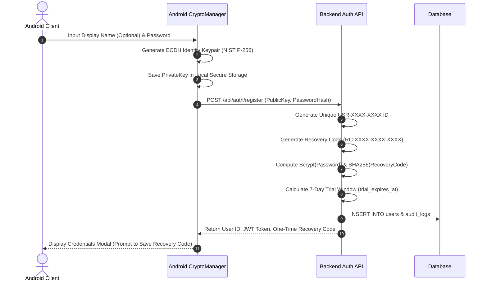
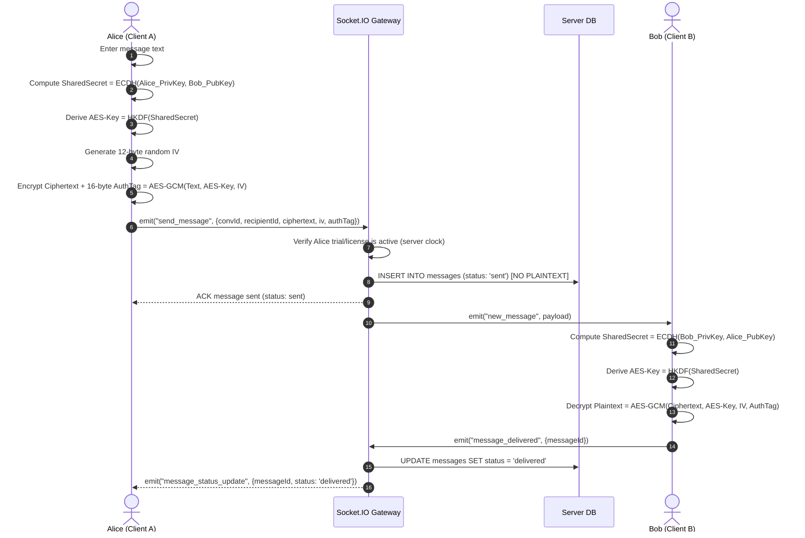
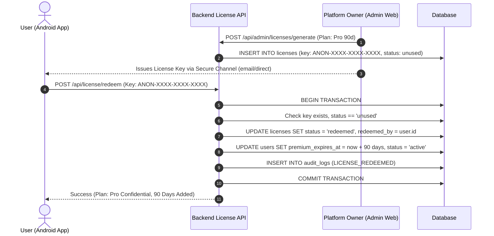
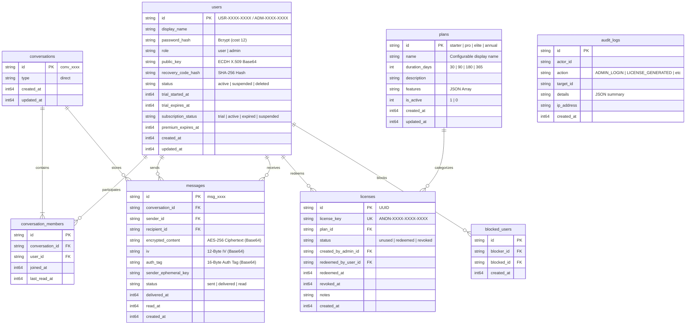

# AnonChat — System Architecture & Component Design

This document details the software architecture, component relationships, data flow diagrams, and database schema for the AnonChat platform.

---

## 1. High-Level Architecture Overview

AnonChat consists of four primary subsystems:
1. **Native Android Application (Java):** Client interface providing zero-identity authentication, client-side E2EE key generation and encryption, `FLAG_SECURE` screen capture defense, and real-time messaging.
2. **Backend Services & API Gateway (Node.js):** REST API and Socket.IO real-time relay service handling identity registration, key discovery, blinded ciphertext relay, trial/licensing enforcement, and admin operations.
3. **Storage Engine (SQLite/PostgreSQL):** High-performance relational database with WAL mode and atomic transaction guarantees.
4. **Web Administrator Panel (HTML5/CSS3/Vanilla JS):** Separate responsive web dashboard for platform administrators to monitor statistics, manage users, generate licenses, configure plans, and inspect audit logs.

```
       +-------------------------------------------------------------+
       |                   AnonChat Architecture                     |
       +-------------------------------------------------------------+

   +-----------------------+                    +--------------------+
   |   Native Android App  |                    | Web Admin Console  |
   |   (Java / Material)   |                    | (Responsive SPA)   |
   | - FLAG_SECURE Window  |                    | - System Stats     |
   | - ECDH + AES-256-GCM  |                    | - User Management  |
   | - Client Key Storage  |                    | - License Gen      |
   +-----------+-----------+                    +---------+----------+
               |                                          |
   (HTTPS / WSS JSON Relays)                 (HTTPS Admin JWT API)
               |                                          |
               +--------------------+---------------------+
                                    |
                        +-----------v-----------+
                        |  AnonChat Gateway     |
                        |  - Express REST APIs  |
                        |  - Socket.IO Server   |
                        |  - Rate Limiting      |
                        |  - Trial/License Svc  |
                        |  - Audit Log Engine   |
                        +-----------+-----------+
                                    |
                               (WAL Engine)
                                    |
                        +-----------v-----------+
                        |   Encrypted Database  |
                        |   - users             |
                        |   - conversations     |
                        |   - messages (cipher) |
                        |   - licenses          |
                        |   - plans (4 tiers)   |
                        |   - audit_logs        |
                        +-----------------------+
```

---

## 2. Core Interaction Flows

### 2.1 User Registration & E2EE Key Provisioning


### 2.2 End-to-End Encrypted Message Relay


### 2.3 Trial Expiry & License Key Redemption


---

## 3. Database Schema Specification


